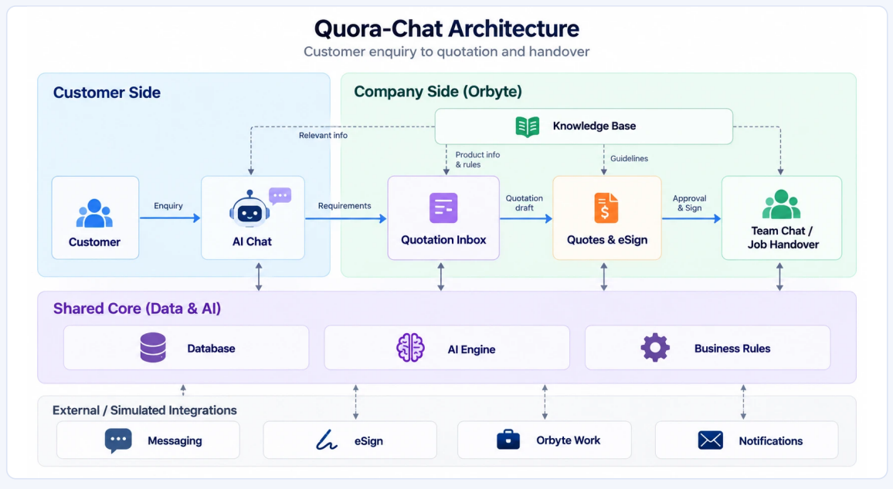

# Quora Chat workflow

This document describes how Quora Chat behaves from the first customer message to a paid, completed job. For setup, see the [README](../README.md) and [SETUP.md](SETUP.md).

All businesses, people, prices and messages are synthetic, team-created demo data. SST rates are illustrative.

## Architecture

- **Customer side:** the customer sends an enquiry to the AI chat, which gathers the requirements.
- **Company side (Orbyte):** requirements arrive in the Quotation Inbox, become a quotation draft in Quotes & eSign, and, once approved and signed, are handed over to the team in Team Chat / Job Handover. The Knowledge Base supplies public information to the AI chat, product information and rules to the inbox, guidelines to quotes, and internal SOPs to the team.
- **Shared core:** every module uses the PostgreSQL database, the AI engine and the business rules.
- **External / simulated integrations:** messaging (WhatsApp), eSign, Orbyte Work and notifications are simulated in this prototype.

## Two sides of the demo

| URL | Who you are | What it is |
| --- | --- | --- |
| `/whatsapp` | The customer | A simulated WhatsApp Web. The chats are the five demo businesses. Send text, photos or documents. Switch customer from the top-left menu. |
| `/orbyte` | The business | An Orbyte workspace: Home, People, **Work** (jobs handed over after signing), eSign, Connect, **Knowledge**, **Products** and **Quotation** (Inbox, Quotes). Notifications are in the sidebar bell. Switch company and signed-in user from the sidebar. |
| `/sign/:quoteId` | The customer | The eSign page linked from WhatsApp. |

Open `/whatsapp` and `/orbyte` in two tabs side by side. People and Connect show sample data only (`src/data/orbyte-static.ts`). Everything else uses the database. Each business has sample customer messages: open an empty WhatsApp chat to tap one.

## From enquiry to quotation

Customers write in English, Bahasa Melayu, Chinese or a mix. Quora Chat gathers requirements first and quotes after:

1. **Works out what they want** from the business's catalog, and asks if it is unclear.
2. **Gathers the details** the business needs, a question or two at a time, in a natural tone and the customer's own language. Each business sets these as **preset questions** per product, per category or for every enquiry. Question types are text, number, date, choices, yes/no, photo or file, and follow-ups that only appear after a certain answer. The AI can draft these questions for the business.
3. **Recaps** the requirements and waits for the customer to confirm.
4. **Drafts the quotation.** Fixed-price items are priced by deterministic code from the catalog and pricing rules. The AI never sets a price. Custom-priced work (software, audits and similar) goes to staff with a structured requirement brief and a price builder.
5. **Staff review and approve** in Orbyte. The quote goes back on WhatsApp as a PDF with a **Review & sign** link (Orbyte eSign).
6. **Revisions.** If the customer asks for changes, the AI confirms them and drafts a revision (`-R2`). Unsigned quotes are replaced on approval. A signed custom project keeps its current agreement until the replacement is signed.

Products carry a SKU, a type (stock item or service) and stock levels. A quote that needs more than is available is flagged, and signing reserves the stock.

### Staff controls

Throughout the conversation, staff can see the live **requirement brief**: each answer, where it came from and what is still missing. Staff can:

- fill in answers, or, as an approver, waive a requirement with a recorded reason;
- add their own question for the AI to ask;
- press **Ask now** or **Draft now**;
- read the AI's reasoning (**AI thinking**);
- **take over** the chat.

Code decides what to ask and when to draft. The AI reads answers and words the messages. Every step is recorded as a simulated Orbyte activity event.

## Requirements and signed agreements

1. The AI extracts each answer with a reference to the customer message it came from, and marks it known, ambiguous or conflicting. Answers without valid customer evidence stay ambiguous. Required answers are validated against the business's preset questions, and unresolved follow-ups keep the request open.
2. Customer confirmation is the normal route to drafting. Approvers can use **Draft now** after the requirements are resolved, or waive individual requirements with a reason. A staff draft does not claim customer confirmation.
3. Substantive edits increase the requirement version and store a snapshot. Presentation-only changes do not. Edits from an out-of-date screen are rejected.
4. Every new quote freezes the requirements, question labels and offering names. Staff see the differences from the previous agreement. Approval requires the current requirement version and blocks on customer messages that have arrived but not been processed.
5. The web quote, signing page and PDF show the captured scope and any waivers. Signing checks the agreement again, then commits acceptance and stock reservations in one transaction and queues the handover. Signing twice does not create a second reservation or job.
6. When a signed custom project changes, the old agreement stays active while the replacement is discussed. Once the replacement is signed, the existing project receives the revised handover. Completed tasks remain, outstanding tasks are blocked, and suggested new tasks are shown separately. The PIC or an approver must acknowledge the revised scope before work continues.

Signed revisions apply to active custom projects without stock items. Completed work and stock orders need a separately reviewed request, so a delivered order or its stock ledger is never changed silently.

## Following up unsigned quotes

Customers often take days to sign. The AI decides when to nudge (based on whether the quote was opened, the customer's deadline and the chat) and writes a short, friendly reminder. Code enforces the business's limits: maximum reminders, days apart, working hours, and never after expiry.

Replies are routed:

- "Later" snoozes reminders until the date the customer gave.
- A price concern pauses reminders and alerts staff. The AI never offers a discount.
- "No thanks" marks the quote **Lost** with the reason.

At expiry the quote is extended once, then marked Lost. Staff can pause, resume, send now or mark lost. Signing cancels pending reminders in the same transaction. A **demo clock** in the sidebar (+1d / +3d / +7d) shows the multi-day flow live.

## Handover after signing

Quora Chat creates the client and a job in **Orbyte Work**, named by what was bought (Delivery order, Job order or Project), and assigns the category's default **PIC**. The AI writes a handover pack: briefing, scope, key requirements, what was promised in chat, watch-outs and starting tasks. The PIC is notified (simulated Orbyte app notification and email). Completing a delivery order hands over its reserved stock.

If the customer explicitly cancels a signed order before delivery or completion, Quora Chat cancels the job, releases that order's stock reservations, voids unpaid invoices and flags paid amounts for refund review. Questions or hypotheticals about cancelling do nothing destructive.

## Team chat per job

Each job has an internal group with the PIC, any workers the PIC or an approver adds, and the AI. The customer is never in it.

- Teammates talk to each other and tag each other with `@Name`, which sends a notification.
- The AI answers only when tagged **`@AI`**. It answers from the signed brief, the quote, the agreement conversation and file references, shows where it found each answer, and suggests actions: add a task, flag a blocker, or ask the customer.
- The AI opens the group with the handover briefing.
- **Ask the customer** drafts a friendly WhatsApp message that sales must approve in the Quotation inbox. Each step shows in the group, and the customer's reply comes back to the group with the team notified.

## Company knowledge base

Each business keeps its SOPs, policies and specs in **Knowledge**. Documents are either:

- **Internal**: only the team AI may read them.
- **Public**: the WhatsApp assistant may answer customers from them.

Code decides which documents each AI receives, so a customer cannot talk the WhatsApp assistant into revealing internal content. The team AI cites the document it used, and the handover pack follows the matching SOPs. The **Who can read what** panel shows what each AI would be given for a question.

## Billing after signing

Every quotation states its payment schedule. Each instalment has a trigger:

- **On signing**: a deposit or full upfront payment.
- **After a phase**: when every task in that quotation phase is done.
- **On completion**.

Custom items take their schedule from their price list. Everything else uses the business's **Billing rules** (Quotes → Billing rules, with an AI "suggest for my trade" option).

Billing then runs by itself. Signing invoices the on-signing part. Finishing a phase's tasks invoices that phase. Ticking the last task completes the job and sends the completion report, the final invoice and the statement of account, as the business chooses.

The customer pays in WhatsApp from the invoice card (**Review and pay → Proceed to pay → Send payment**). This uses a simulated saved card, with no real payment gateway. Staff can also record a bank transfer or cash payment on the job's **Billing** tab. Every payment gets an official receipt PDF. Unpaid invoices get polite AI-timed reminders within the business's limits. Once everything is paid, the job closes.

## Handover worker and recovery

Handover work is queued in the `workflow_tasks` table and processed by a separate worker (`pnpm worker`, or together with the web server through `pnpm dev` and `pnpm start:with-worker`). The follow-up scheduler runs inside the web process.

- Workers claim a task with a five-minute lease and a claim token. A task's effects and its completion commit in the same transaction, so a replaced claim cannot commit stale results.
- If a worker stops, its task becomes available again when the lease expires. Failed attempts are retried.
- A superseded quote generation is discarded instead of overwriting a newer handover.
- The job page shows failed handover preparation and offers a retry. Fix the AI or provider error first, then retry from that page. If job creation fails repeatedly before a job exists, check the worker log and `workflow_tasks.last_error`.

## Demo replay mode

Setting `AI_MODE=replay` replaces the model with a predictable, clearly labelled stand-in for live demos. Only the AI's language work is replaced. Readings are scripted for the flagship scenario lines, and anything off-script is handed to staff instead of being guessed. Replies, handovers and team answers are written from templates using the same inputs the model would receive. Pricing, requirement checks, approvals, signing, jobs and permissions run exactly as in live mode.

## Known limitations

- The staff identity selector is a demo feature, not production authentication.
- WhatsApp, Orbyte, email delivery and payments are simulated.
- File references are available to the AI, but text is not yet extracted from uploaded documents.
- Structured answer evidence and deterministic validation reduce mistakes in scope. Real-provider multilingual evaluation and business-specific acceptance tests are still needed before use with real customers.
